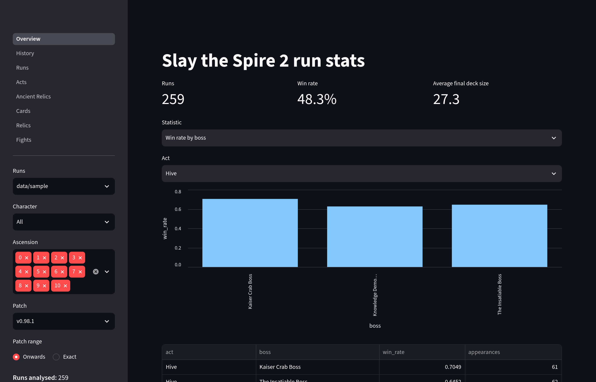
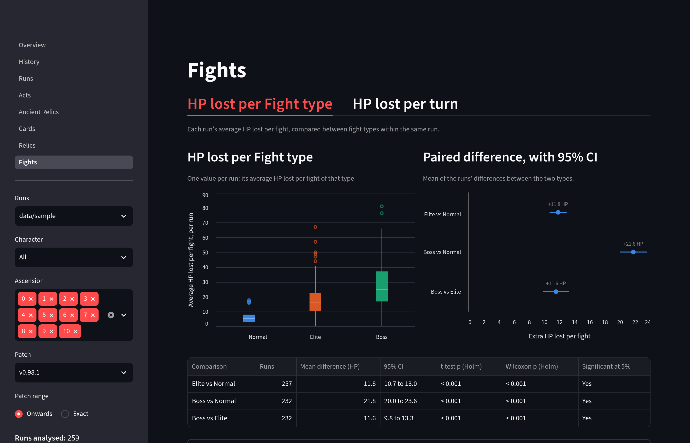
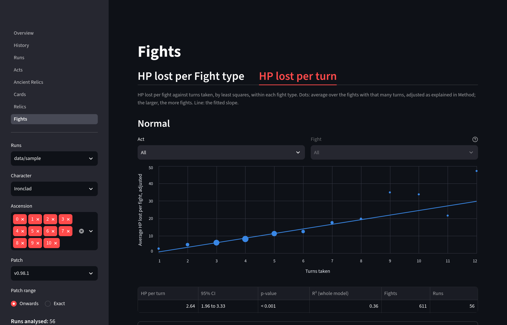
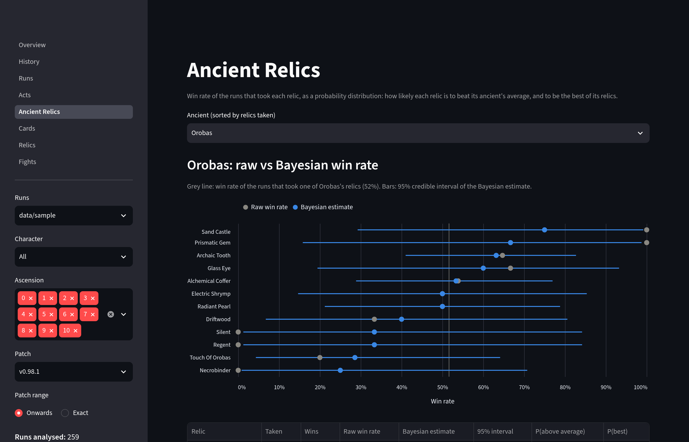
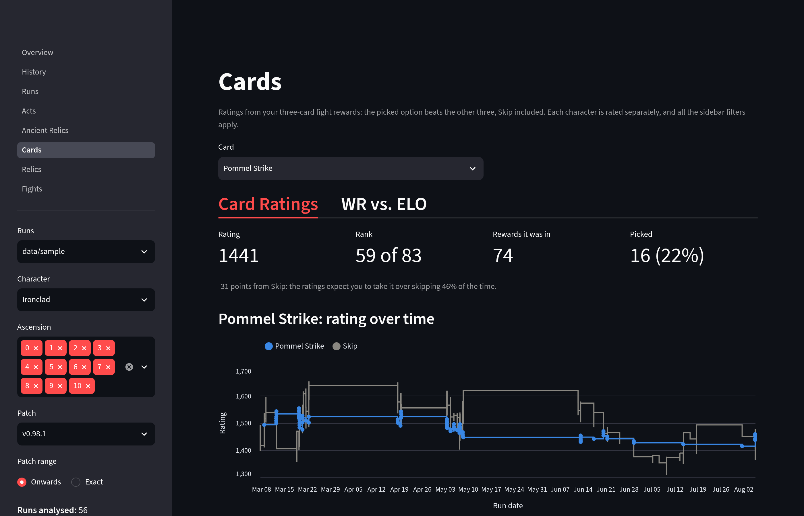
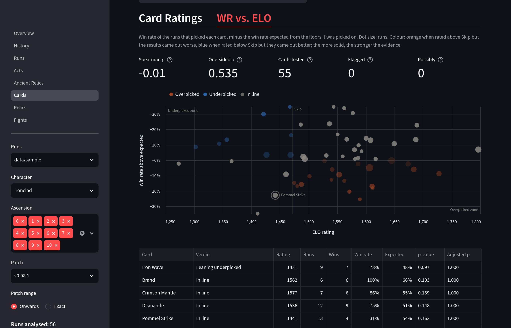

# sts2-run-analyzer

Data analyzer for *Slay the Spire 2* Runs: it parses the game's Run history
files (`.run`, JSON format) into a local SQLite database, analyses them with SQL
and Python, and shows the results in a Streamlit dashboard.

Beyond plain win rates (WR), it runs **statistical tests and models** on your Runs: paired/hypothesis tests, regressions, Bayesian models, ELO systems and more! 

The detailed explanations for every test and model used are in [docs/methods.md](docs/methods.md). 

> [!WARNING]
> **Work in progress.** Many parts are unfinished, and the code, database schema and queries are changing often.
> Expect many bugs and other issues. See [TODO.md](TODO.md) for the full "plan" of the project. 

> [!WARNING]
> **Latest patch (12 November 2026).** No adjustments have been made yet for Blitz mode or Dread mode, so they are *not* filtered out (and might interact wrongly with Ascension filters). Everything concerning The Fool should be okay (tested with Runs from v0.113.1).

**Disclaimer:** This is a personal project for fun and for learning, shared on the off-chance it becomes useful for someone. There are much better, user-friendly projects of a similar scope, see e.g. https://www.app-scry.com/. 

## How to use

1. **Get your Runs.** The game writes one `.run` file per Run, in the save
   folder under `.../remote/profile1/saves/history` on Steam (the exact location
   depends on your system). Copy everything into `data/` as (at least) one folder.
2. **Install** Python 3 with pandas, NumPy, SciPy, Streamlit and Altair, in a
   virtual environment (see [Setup](#setup)).
3. **Run it.** List your folders of `.run` files in `paths` inside `src/main.py`. With the virtual environment active, run
   `python src/main.py`. It first parses every Run
   into `data/runs.db`, then it opens the dashboard at
   <http://localhost:8501>. Stop it with `Ctrl+C` and reopen it
   with `streamlit run src/app.py`.
4. **Explore.** The sidebar holds the pages and the filters.

Run everything from the repository root. After a change to `sql/schema.sql`,
delete `data/runs.db` and run `main.py` again (both `main.py` and the dashboard
warn you). Always restart the dashboard after editing the code.

## Setup

The project needs a few packages that are not part of Python itself. Install them
in a **virtual environment** (venv).
On many Linux distributions (Arch, recent Debian and
Ubuntu,...) it is in fact required.
 Elsewhere, it is still recommended. 

Create it once, from the repository root:
```bash
python3 -m venv .venv
source .venv/bin/activate        # Windows: .venv\Scripts\activate
pip install pandas numpy scipy streamlit altair
```

Activation only lasts for the terminal it was run in. So every time you open the project in a
new terminal type these from the repository root:
```bash
source .venv/bin/activate        # Windows: .venv\Scripts\activate
python src/main.py               # or whatever you want to run
```
To leave the venv type `deactivate`.

## Sample Runs

For you to try out the project: `data/sample/` holds 273 of my own Runs, from patches v0.98.1 to v0.110.1. It includes all Characters 
(Ironclad, Silent, Regent, Necrobinder and Defect) and all  Ascensions. It is listed in `paths` in `src/main.py`.
Multiplayer Runs are skipped, so the dashboard analyses 259 of them (the other 14 are multiplayer).

> [!NOTE]
> These Runs are rather old, I didn't want to look at recent stats for now (hopefully win-rate is looking better...).

## Methods

Using the dashboard should be intuitive: every page starts with a short
description of what you are looking at and all charts have captions. 
How each metric and test is computed, with its formulas, distributions
and blind spots, is in **[docs/methods.md](docs/methods.md)**.

## Structure

- `TODO.md`: planned analyses, simplifications to revisit and known issues.
- `data/`: your Run folders.
  - `sample/`: 273 anonymised Runs (259 single-player) to try the project with (see [Sample Runs](#sample-runs)).
  - `runs.db`: the SQLite database built by `main.py`.
- `docs/`
  - `methods.md`: documentation for how every metric and test is computed.
  - `images/`: the screenshots below.
- `sql/`
  - `schema.sql`: the database tables.
  - `queries/`: one (convenient) summary statistic per file.
    - `win_rate.sql`
    - `deck_size.sql`
    - `boss_win_rate.sql`
    - `acts.sql`
    - `ancient_win_rate.sql`
    - `ancient_relic_win_rate.sql`
    - `cards_per_act.sql`
  - `analysis/`: row-level data for the statistics in `src/analysis/`.
    - `fights.sql`
    - `ancient_relics.sql`
    - `card_rewards.sql`
    - `run_lengths.sql`
- `src/`
  - `main.py`: Checks the schema, ingests `paths`, prints
    the tables and starts the dashboard.
  - `run.py`: the `Run` class, which parses one `.run` file into DataFrames.
  - `ingest.py`: loads a folder of Runs into `data/runs.db`, skipping duplicates
    and multiplayer Runs.
  - `queries.py`: how the Dashboard and `print_tables.py` read the database. It
    takes a folder of `.sql` files, fills the sidebar filters into their placeholders, runs each one on `runs.db`
    and returns its result as a pandas table.
  - `print_tables.py`: prints every `sql/queries/` table for each Character.
  - `app.py`: the Streamlit entry point.
  - `analysis/`: the statistics.
    - `__init__.py`: constants and helpers shared by the analyses.
    - `hp_per_fight_type.py`
    - `hp_per_turn.py`
    - `ancient_relics.py`
    - `card_picks.py`
  - `dashboard/`: one module per Dashboard page.
    - `common.py`: shared helpers for the filters, name formatting, chart colours
      and the "Method" boxes.
    - `overview.py`: (TODO)
    - `history.py`: (TODO).
    - `runs.py`: (TODO).
    - `acts.py`: (TODO).
    - `ancient_relics.py`:
    - `cards.py`
    - `relics.py`: (TODO).
    - `fights.py`

## Output samples

Screenshots of the dashboard on the [sample Runs](#sample-runs), just to get a feel for the output. Cosmetics still need some work!

<table>
<tr>
<td width="50%"><br><b>Overview:</b> Win-rate by Boss, coloured by Act.</td>
<td width="50%"><br><b>Overview:</b> Win-rate by Boss, in one Act.</td>
</tr>
<tr>
<td><br><b>Overview:</b> Survival rate by Act, for the Ironclad.</td>
<td><br><b>Overview:</b> Win-rate by Ancient.</td>
</tr>
<tr>
<td><br><b>Fights, HP lost per Fight type:</b> One value per Run, and the paired differences.</td>
<td><br><b>Fights, HP lost per turn:</b> HP lost against turns taken, for Normal Fights of the Ironclad.</td>
</tr>
<tr>
<td><br><b>Ancient Relics:</b> Raw (grey) and Bayesian (blue), for Orobas Relics. The intervals are wide because most Relics were taken in only a few Runs; see <a href="docs/methods.md#ancient-relics">methods.md</a>.</td>
<td><br><b>Cards, Card Ratings:</b> one Ironclad Card's rating over time, against Skip's.</td>
</tr>
<tr>
<td><br><b>Cards, Win-rate vs. ELO:</b> Ironclad Cards, win-rate against ELO rating.</td>
</tr>
</table>

## License

[MIT](LICENSE).

