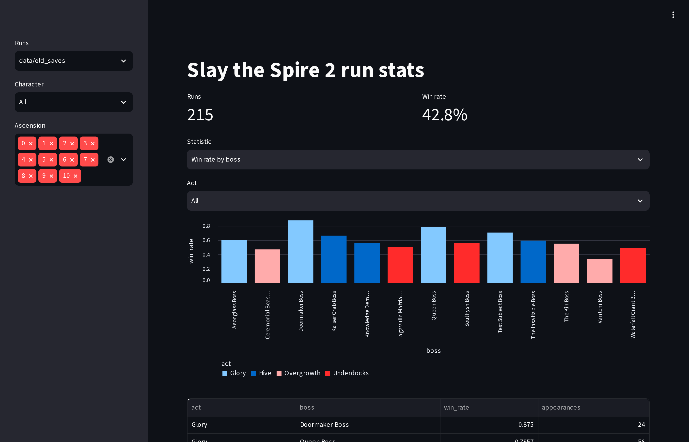
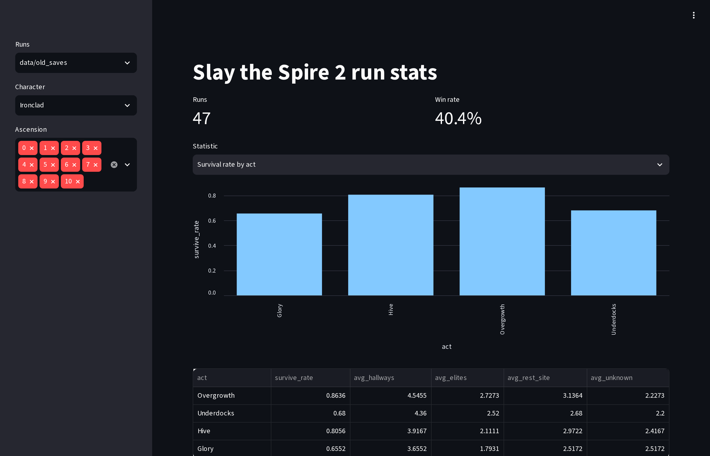
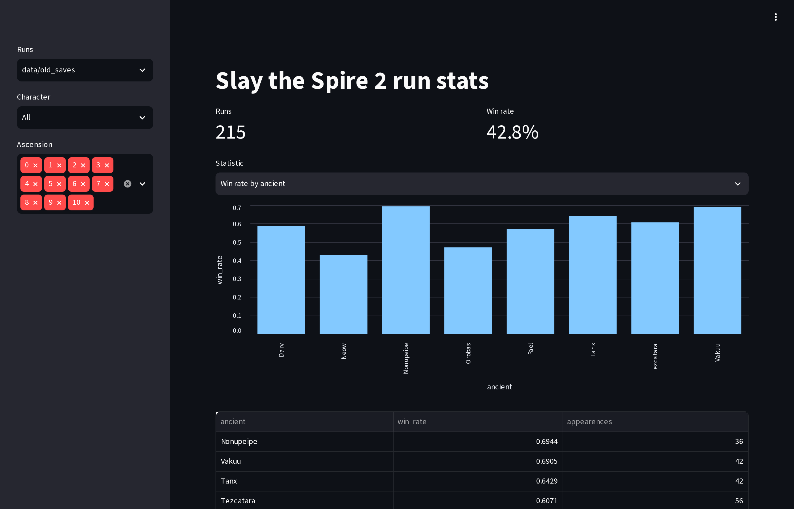

# sts2-run-analyzer

Data analyzer for *Slay the Spire 2* runs. The scripts parse the game's run history
files (`.run`, JSON format) into a local SQLite database, then run SQL queries. The final output is a Streamlit dashboard. 

> [!WARNING]
> **Work in progress.** Many parts are unfinished, and the code, database schema and queries are changing often.
> **For now**: only basic win-rate queries implemented, more elaborate metrics and hypothesis testing in the works!
> Expect many bugs and other issues.

**Disclaimer** This is a personal project for fun and for learning, shared on the off-chance it becomes useful for someone. There are much better, user-friendly projects of a similar scope, see e.g. https://www.app-scry.com/. 


## Structure

```
data/            Your run files. Also holds runs.db once built.
sql/
  schema.sql     Table definitions for the SQLite database.
  queries/       One .sql file per statistic, all run automatically on export.
src/
  run.py         Run class: parses a single .run file into dataframes.
  ingest.py      Loads parsed runs into data/runs.db (skips duplicates and multiplayer runs).
  export.py      Runs every query in sql/queries/, and defines the Streamlit dashboard.
  main.py        Entry point: ingests the runs, prints the results and starts the dashboard.
```

## Data

The `data/` directory is **not** included in the repository, except for one
anonymised example, `data/sample.run`. To use the project, add your own run
files locally. 

Run history files are written by the game. On Steam they are in the save
folder under `.../remote/profile1/saves/history`, but the exact location
depends on your system.

## Usage

### Requirements

- Python 3
- [pandas](https://pandas.pydata.org/)
- [Streamlit](https://streamlit.io/) 

> [!NOTE]
> This list is not final and will be updated as the project grows.

### Running the scripts

1. **Point `main.py` at your runs.** Set `path` in `src/main.py` to a folder
   of `.run` files. There is no need to copy them into `data/`: you can point
   directly at the game's own run history, which is the `history` folder inside
   the save folder (on Steam, `.../remote/profile1/saves/history`). If you do
   prefer a copy, a folder such as `data/my_runs/` works too. The path is
   hard-coded for now. 
2. **Run the main script** from the repository root:

   ```
   python src/main.py
   ```

`main.py` then goes through three steps:

1. **Ingest:** parses every `.run` file in `path` and stores it in
   `data/runs.db`. Runs already in the database and multiplayer runs are
   skipped, so it is safe to run again after adding new files.
2. **Export:** runs every query in `sql/queries/` for each character. Also prints
   the resulting tables in the terminal for now (to help with debugging).
3. **Dashboard:** starts a local Streamlit server and opens the dashboard in
   your browser at <http://localhost:8501>. If the browser doesn't open by
   itself, go to that address. The dashboard keeps running until you press
   `Ctrl+C` in the terminal.

To open the dashboard again without re-running the ingest and export steps:

```
streamlit run src/export.py
```

### Using the dashboard

> [!NOTE]
> **Work in progress.** Instructions for the dashboard will be added here once its format is final.

## Output samples

Screenshots of the dashboard, just to get a feel for the output: **it still needs a lot of work!**. 


**Win rate by boss, all characters.** The colour encodes the acts. 



**Win rate by boss, filtered to one act.**


**Survival rate by act, for one character.** The table also shows the average
number of hallway fights, elites, rest sites and unknown rooms per act.



**Win rate by ancient.**



> [!NOTE]
> These are rather old runs, I didn't want to look at recent stats for now (hopefully win rate is looking better...)